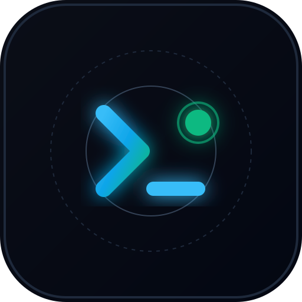

# InspectLog ⚡
> Commercial-grade developer web & API network inspector. Intercept network payloads ("lemparan"), responses ("balasan"), query parameters, status codes, console logs, uncaught JS crashes, multi-page crawler, scheduled monitoring with Telegram/Discord alerts, and instant HAR 1.2 export.



[](https://nextjs.org/)
[](https://playwright.dev/)
[](https://www.typescriptlang.org/)
[](https://sqlite.org/)
[](https://web.dev/progressive-web-apps/)
[](https://opensource.org/licenses/MIT)

---

## 🌟 Key Features

- **Deep Network Interception**: Captures every HTTP request, AJAX fetch, status code, duration, request headers, payload body, and response body with right-aligned timings and syntax highlighting.
- **Console & Uncaught Crash Detection**: Listens to browser `console.error`, `console.warn`, and uncaught JavaScript runtime exceptions with stack traces.
- **Device & Viewport Emulation**: Toggle between **Desktop (1440x900)** and **Mobile (iPhone 14, 390x844)** with touch event emulation and iOS User-Agent.
- **Multi-Page Crawler**: Automatically traverses internal links on the same origin (up to 10 pages) to discover broken API routes and script crashes across the entire application.
- **Export to HAR 1.2**: Generates standard HTTP Archive (HAR 1.2) files compatible with Chrome DevTools, Postman, Charles Proxy, and Fiddler.
- **Markdown Bug Dev Report**: 1-click formatted bug ticket copy ready to paste into Jira, GitHub Issues, or Slack.
- **Scheduled Uptime Probes**: Automated background monitoring with Telegram bot and Discord/Slack webhook incident alerts.
- **Public Status Page (`/status/[id]`)**: Transparent public uptime status page with 30-check response time tick bar and incident history.
- **Progressive Web App (PWA)**: Full offline-capable PWA manifest, multi-resolution app icons, and mobile bottom navigation bar.
- **Military-grade SSRF Protection**: Restricts scans against localhost (`127.0.0.1`), loopbacks, private CIDR ranges (`10.0.0.0/8`, `172.16.0.0/12`, `192.168.0.0/16`, `169.254.0.0/16`), and DNS rebinding attacks.

---

## 🚀 Quick Start (Local Development)

### 1. Clone repository
```bash
git clone https://github.com/choiruldev/inspectlog.git
cd inspectlog
```

### 2. Install dependencies
```bash
npm install
```

### 3. Run development server
```bash
npm run dev
```
Open [http://localhost:3000](http://localhost:3000) in your browser.

---

## 🐳 Production Deployment with Docker

InspectLog includes an official Microsoft Playwright container Dockerfile pre-bundled with headless Chromium.

### Run in 1 command:
```bash
# 1. Setup environment file
cp .env.example .env

# 2. Start container in background
docker compose up -d --build
```
Your instance will be running on port `3000`, with all SQLite database records persisted in `./data`.

---

## ⚙️ Environment Variables

Refer to [`.env.example`](.env.example) for all optional configuration keys:

| Variable | Description | Default |
| :--- | :--- | :--- |
| `NODE_ENV` | Environment mode (`production` or `development`) | `development` |
| `PORT` | Listening server port | `3000` |
| `CRON_SECRET` | Secret token to authorize scheduled cron checks (`/api/cron/check`) | `None` |
| `ADMIN_KEY` | Admin authorization key to view feedback logs (`/api/feedback`) | `None` |
| `PASSWORD_SALT` | Custom cryptographic salt for user password hashing | Internal default |
| `GOOGLE_CLIENT_ID` | Google Cloud OAuth Client ID (Optional) | `None` |
| `GOOGLE_CLIENT_SECRET` | Google Cloud OAuth Client Secret (Optional) | `None` |
| `MIDTRANS_SERVER_KEY` | Midtrans Production Server Key for paid tiers (Optional) | `None` |
| `GEMINI_API_KEY` | Google Gemini API Key for AI error diagnostics (Optional) | `None` |

---

## 💼 Monetization & Paid Pro Tiers

InspectLog is set to **100% Free / Community Mode** by default. All payment gateway logic (Midtrans Snap, webhooks, and billing tables) is pre-built and documented in:
📄 [`PRO_MONETIZATION_GUIDE.md`](PRO_MONETIZATION_GUIDE.md)

---

## 📄 License

MIT License — free for personal and commercial use.
